# Creating a User

The plugins call AWS with the credentials of an IAM user. This page creates a user with an access key. The screenshots use GameLift, but the steps are the same for every service.

:::tip
For a shipped game client, don't use a long-lived access key. Use temporary credentials from a [Cognito identity pool](/plugins/cognito/sign_in), or call AWS from your own backend.
:::

## Open IAM
Log in to the [AWS Console](https://console.aws.amazon.com/) and open **IAM**.

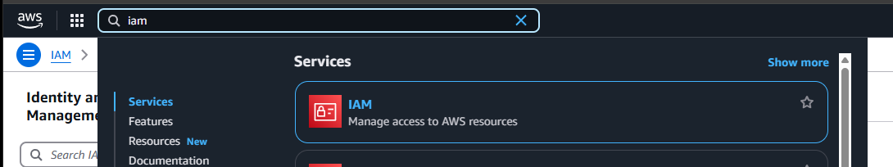

## Create the user
Click **Users**, then **Create user**.

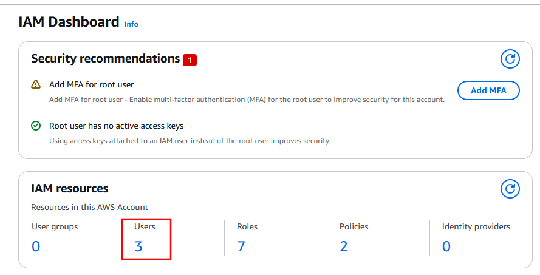

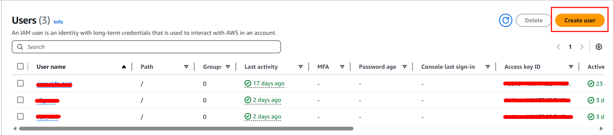

Give the user a name.

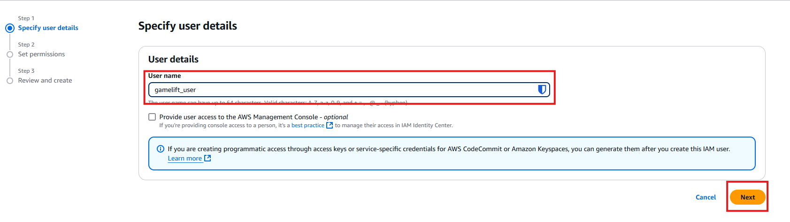

Select **Attach policies directly**, then review and create the user.

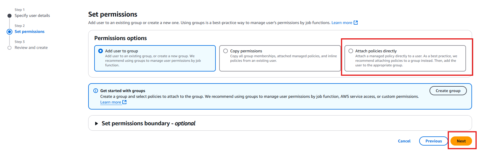

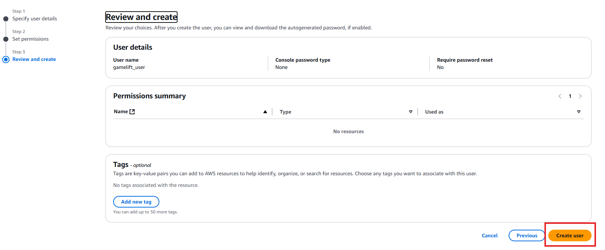

## Give the user permissions
Open the user you created, click **Add permissions** and **Create inline policy**.

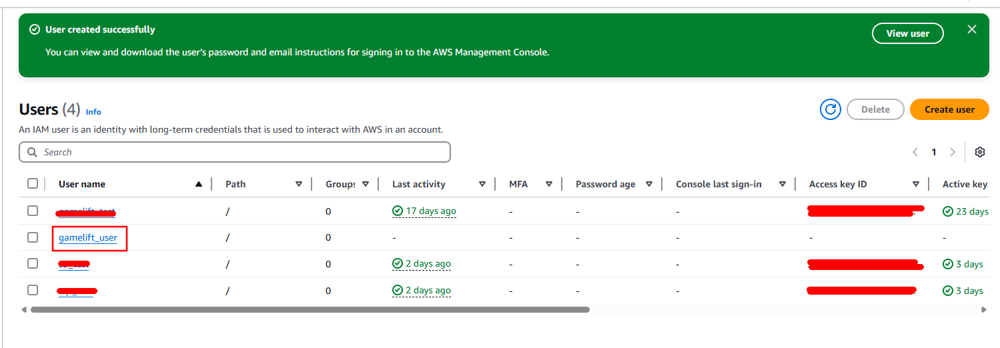

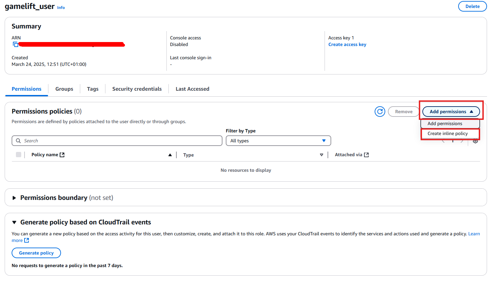

Search for the service you want to use, for example GameLift, S3 or DynamoDB.

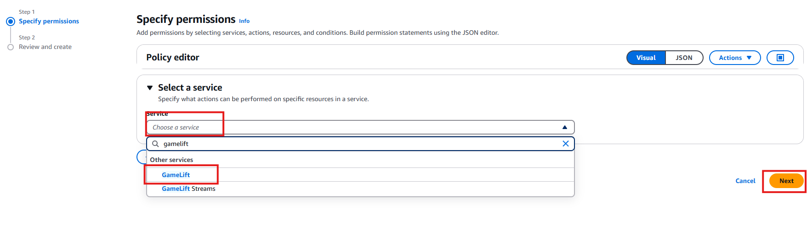

Select the actions and resources the user needs.

:::danger
The screenshots allow **all** actions on **all** resources. That is only for testing. In a release, only allow the actions and resources your game actually uses.
:::

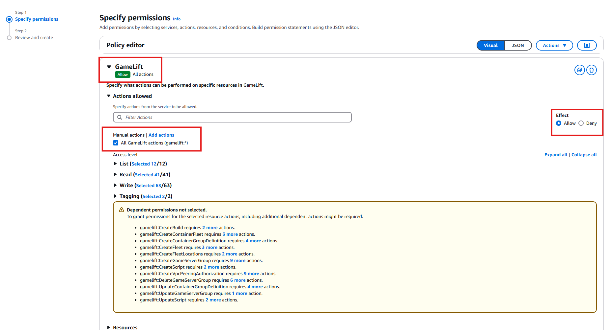

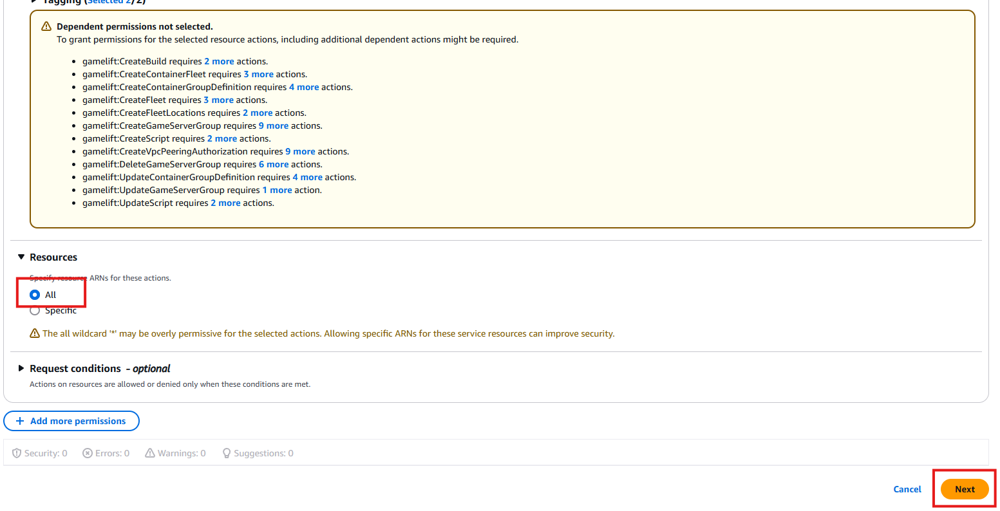

Review and create the policy.

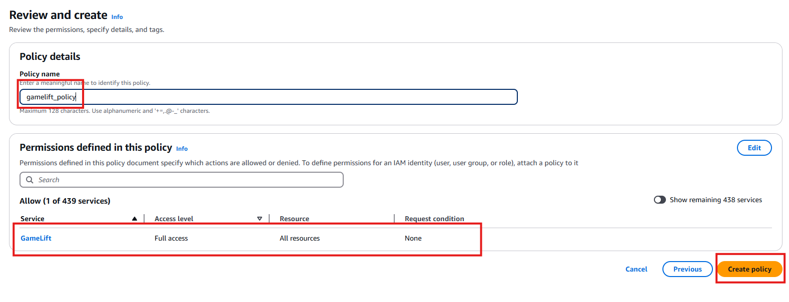

## Create an access key
Open **Security credentials** and click **Create access key**.

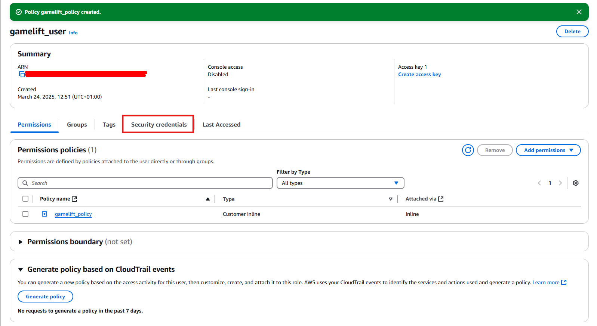

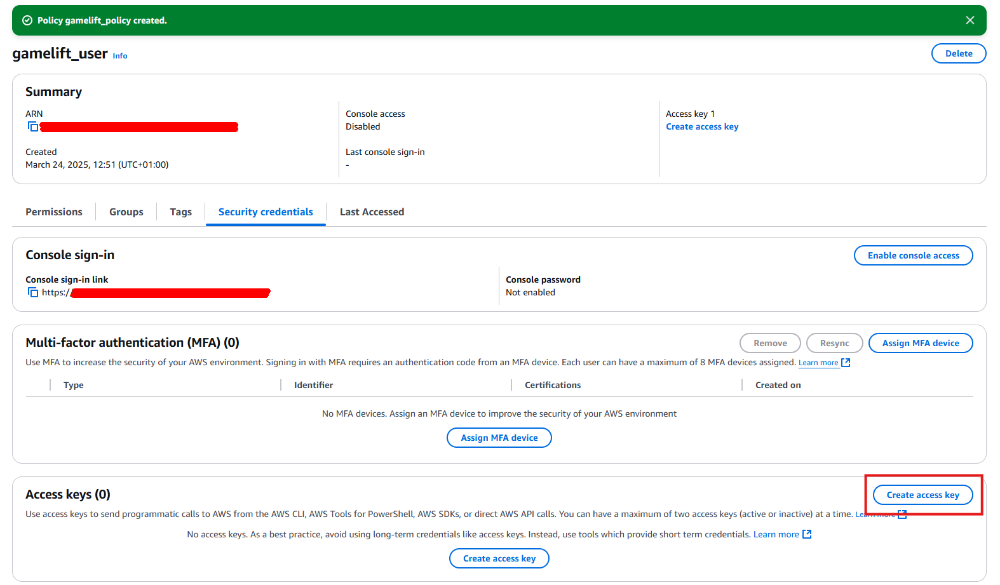

Read the warning about access keys and continue.

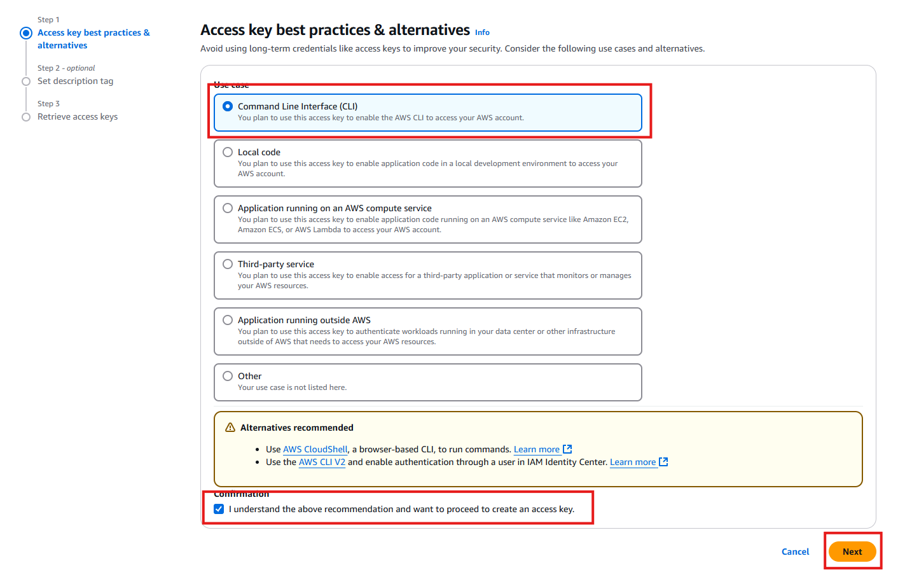

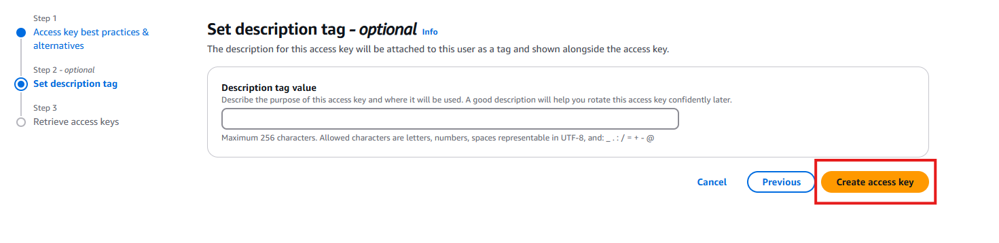

Download the `.csv` file. The **Access Key Id** and **Secret Key** in it are what you use when you [create the client object](/initializing_plugin). The secret key can't be shown again later.

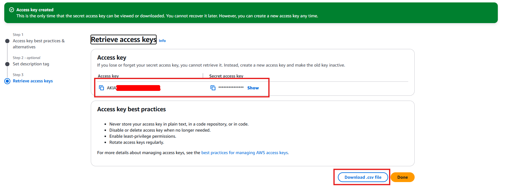
