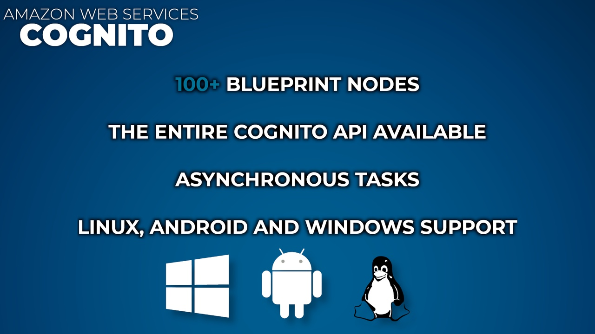
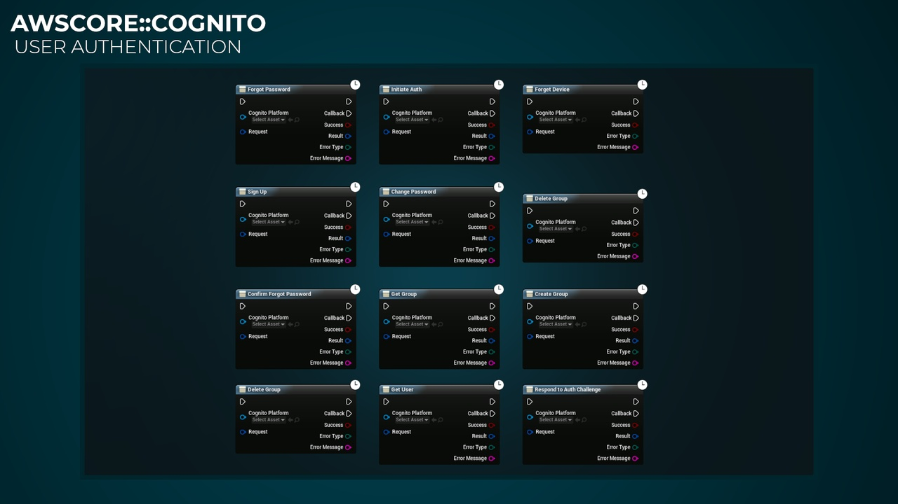
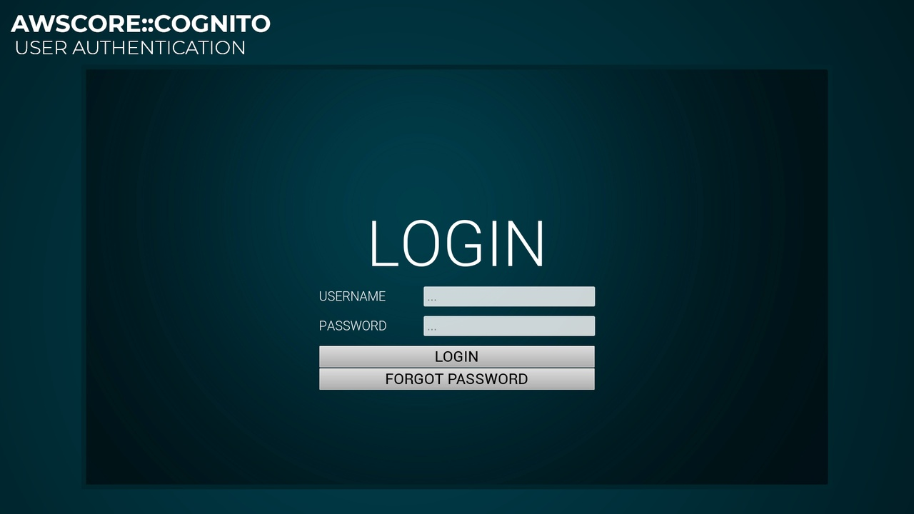

import Tabs from '@theme/Tabs';
import TabItem from '@theme/TabItem';

# Cognito

The Cognito plugin lets you use Amazon Cognito from Blueprint. Use it to let players create accounts and sign in, and to give signed-in players temporary AWS credentials for the other plugins.

## Features
- **User pools** (Cognito Identity Provider): Sign Up, Confirm Sign Up, Initiate Auth, Respond To Auth Challenge, Forgot Password, Change Password, Global Sign Out, MFA and devices.
- **Admin actions** for a backend or tool: create, delete, enable, disable and update users, groups and passwords.
- **User pool management**: user pools, app clients, domains, identity providers, resource servers and user import jobs.
- **Identity pools** (Cognito Identity): Get Id and Get Credentials For Identity give a player temporary AWS credentials, for example for S3 or DynamoDB.
- **Generate Secret Hash** for app clients that have a client secret.
- All nodes have the same names as in the [Cognito API Reference](https://docs.aws.amazon.com/cognito-user-identity-pools/latest/APIReference/Welcome.html).

<Tabs>
  <TabItem value="image" label="Image" default>
    
  </TabItem>
  <TabItem value="image2" label="Image 2">
    
  </TabItem>
  <TabItem value="image3" label="Image 3">
    
  </TabItem>
</Tabs>

## Requirements
| | |
|---|---|
| Target platforms | Windows, Linux, Mac, Android, iOS |
| Unreal Engine | See the [Fab listing](https://www.fab.com/listings/f1f448f1-0d7b-4f78-81ea-7b28ea518328) for the supported engine versions |

## Where to go next
1. [Install the plugin](/installing_plugin)
2. [Getting Started](/plugins/cognito/getting_started)
3. [Sign-up and sign-in](/plugins/cognito/sign_in)
