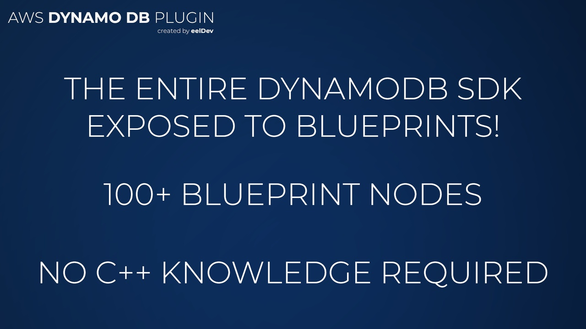
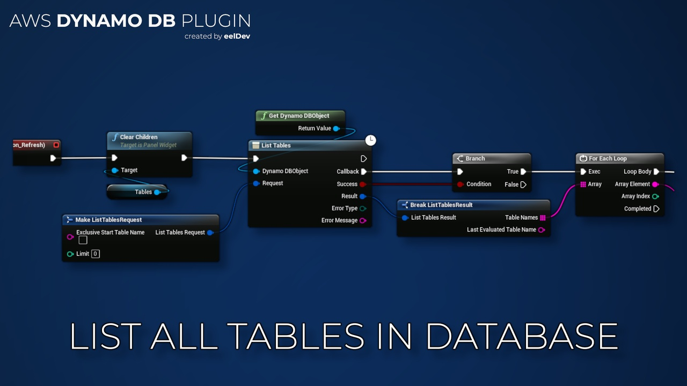

import Tabs from '@theme/Tabs';
import TabItem from '@theme/TabItem';

# DynamoDB

The DynamoDB plugin lets you use Amazon DynamoDB from Blueprint. DynamoDB is a key-value and document database. Use it for player profiles, inventories, leaderboards and other game data.

## Features
- **Items**: Get Item, Put Item, Update Item, Delete Item, Batch Get Item and Batch Write Item.
- **Queries**: Query and Scan with key conditions, filters and paging.
- **Transactions**: Transact Get Items and Transact Write Items.
- **PartiQL**: Execute Statement, Batch Execute Statement and Execute Transaction with SQL-like statements.
- **Tables**: create, describe, update and delete tables, global tables, time to live, backups, exports and imports.
- All nodes have the same names as in the [DynamoDB API Reference](https://docs.aws.amazon.com/amazondynamodb/latest/APIReference/Welcome.html).

<Tabs>
  <TabItem value="image" label="Image" default>
    
  </TabItem>
  <TabItem value="image2" label="Image 2">
    
  </TabItem>
</Tabs>

## Requirements
| | |
|---|---|
| Target platforms | Windows, Linux, Mac, Android, iOS |
| Unreal Engine | See the [Fab listing](https://www.fab.com/listings/504ddb39-2b89-4b5c-aeb1-ae1e9b2afd66) for the supported engine versions |

## Where to go next
1. [Install the plugin](/installing_plugin)
2. [Getting Started](/plugins/dynamodb/getting_started)
3. [Reading and Writing Items](/plugins/dynamodb/items)
