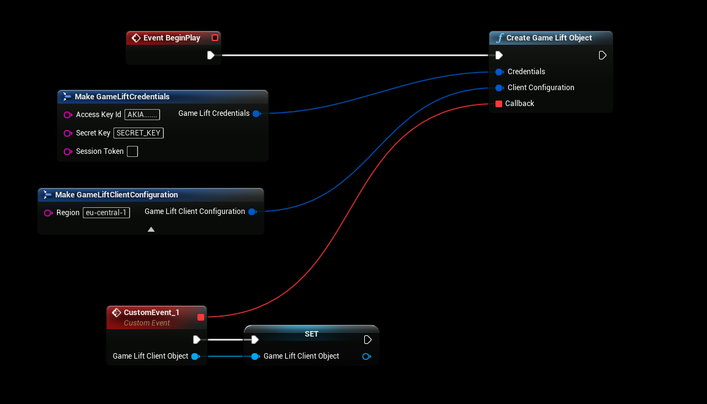
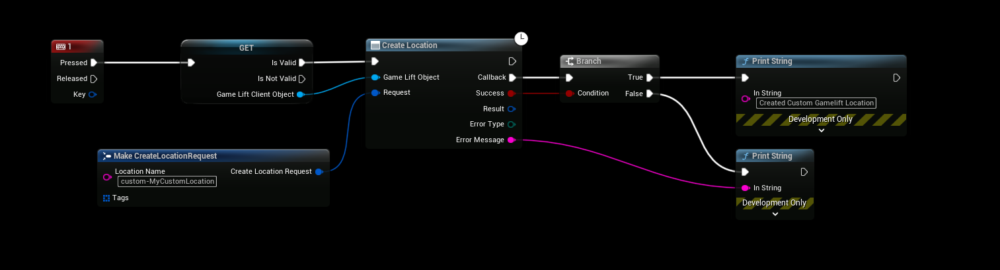

# Getting Started

All GameLift Client nodes need a **GameLift Client Object**. You create it once with your AWS credentials and region, store it, and pass it to every node.

## 1. Create an IAM user
Create an IAM user or role with permission to use GameLift, and an access key for it. See [Creating a User](/creating_user).

## 2. Create the client object
Call **Create Game Lift Object** with:

| Input | Description |
|---|---|
| Credentials | **Access Key Id** and **Secret Key** of the IAM user. Add a **Session Token** if you use temporary credentials, for example from STS or Cognito. |
| Client Configuration | The **Region** of your fleets, for example `eu-central-1`. The other settings are timeouts, proxy and endpoint options, and can be left at their defaults. |
| Callback | An event that is called when the client object is ready. |

The client object is created in the background. Wait for the **Callback**, store the **Game Lift Client Object** in a variable, and only use it after that.

:::warning
Store the client object in a variable. If you call a node before the callback, or with an empty variable, the node fails with `Client object is not valid, create it and wait for its callback before calling this function` in the log.
:::

When you are done with it, call **Destroy Game Lift Object** to free it.

## 3. Call a node
All GameLift actions are async nodes. Pass the client object and a request, and use the **Callback** pin. The node calls it when GameLift has answered, with:

| Output | Description |
|---|---|
| Success | True if the call succeeded. |
| Result | The response from GameLift. Not every node has one. |
| Error Type | The GameLift error, for example `NOT_FOUND`, `INVALID_REQUEST` or `LIMIT_EXCEEDED`. |
| Error Message | The error message from GameLift. |

This example creates a custom location for GameLift Anywhere:

All nodes have the same names as the actions in the [GameLift API Reference](https://docs.aws.amazon.com/gamelift/latest/apireference/Welcome.html), so you can follow the AWS documentation for what each request field does.

## Next steps
- [Game Sessions & Matchmaking](/plugins/gameliftclient/sessions_and_matchmaking): get players into a server.
- [GameLift Anywhere](/plugins/gameliftserver/gamelift_anywhere): register your own machine as a server.
- [Blueprint Nodes](/plugins/gameliftclient/blueprint_nodes): all nodes in the plugin.
