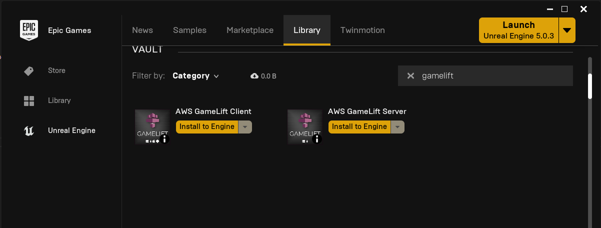
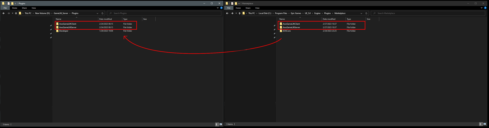
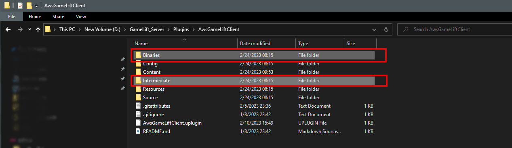

# Installing the Plugin

Install the plugin to your engine from the Epic Games Launcher.



## Move the plugin to your project
The launcher installs the plugin in the engine's Marketplace folder, for example:

```
C:\Program Files\Epic Games\UE_5.x\Engine\Plugins\Marketplace
```

Move the plugin folder to the **Plugins** folder of your project. Create the Plugins folder if your project doesn't have one.

:::warning
**Move** the plugin, do not copy it. If the plugin is in both the engine and the project, the engine may load the wrong one.
:::



## Clean the plugin
Delete the **Binaries** and **Intermediate** folders inside the plugin folder, so the plugin is built together with your project.



## Enable the plugin
Open your project, go to **Edit > Plugins**, search for **GameLiftClient** and enable it. Restart the editor when asked.

Next: [Getting Started](/plugins/gameliftclient/getting_started)
