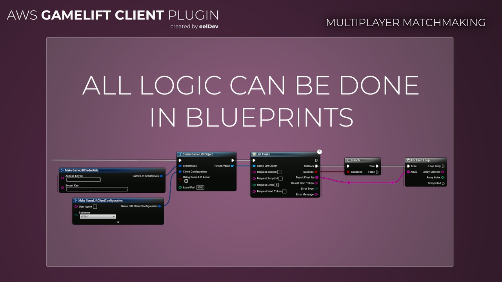
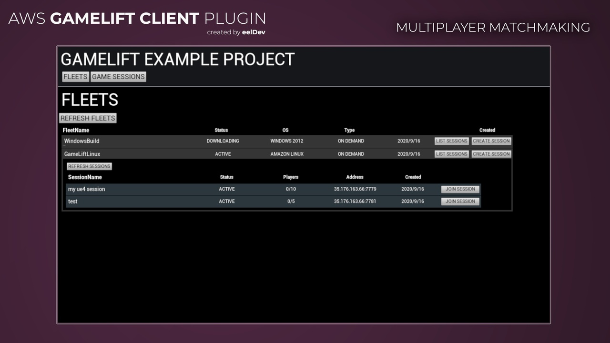
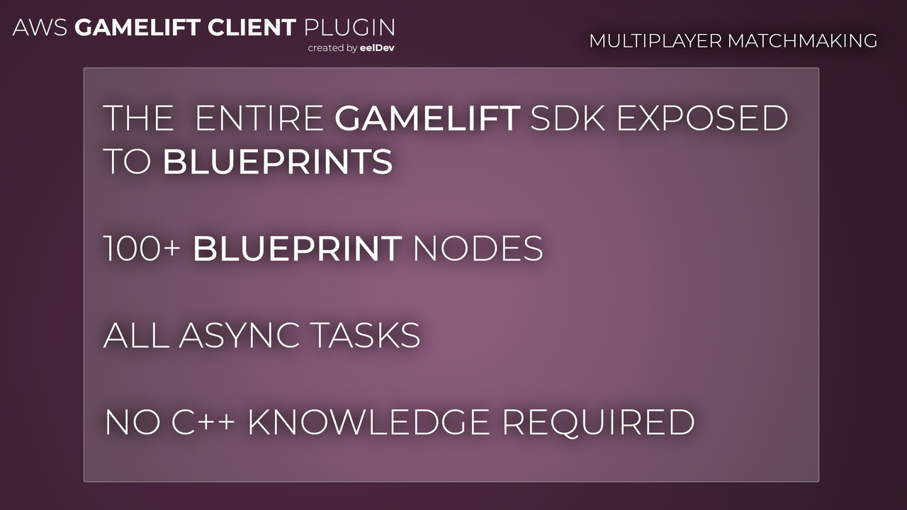

import Tabs from '@theme/Tabs';
import TabItem from '@theme/TabItem';

# GameLift Client

The GameLift Client plugin gives you the Amazon GameLift service API in Blueprint. Use it to create game sessions and player sessions, run FlexMatch matchmaking, and manage fleets, builds, queues and GameLift Anywhere computes.

The plugin is built on the **AWS SDK for C++ 1.11**.

## Features
- **Over 100 async Blueprint nodes**, one for each GameLift API action, with the same names as in the [GameLift API Reference](https://docs.aws.amazon.com/gamelift/latest/apireference/Welcome.html). See [Blueprint Nodes](/plugins/gameliftclient/blueprint_nodes).
- **Game sessions and player sessions**: create, search, describe and update them. See [Game Sessions & Matchmaking](/plugins/gameliftclient/sessions_and_matchmaking).
- **FlexMatch matchmaking**: start, describe, accept and stop matchmaking, and backfill matches.
- **Game session placement** through queues.
- **Fleet management**: fleets, locations, capacity, scaling policies, builds, scripts and aliases.
- **GameLift Anywhere**: custom locations, register computes and get auth tokens for your own servers.
- **FleetIQ**: game server groups and game servers.

## Server plugin or Client plugin?
| Plugin | Runs on | Used for |
|---|---|---|
| [GameLift Server](/plugins/gameliftserver/intro) | The dedicated server | Talking to GameLift from the server process: ready, game sessions, health checks, player sessions, backfill. |
| GameLift Client | A backend, tool or game client | The GameLift service API: creating game sessions and player sessions, matchmaking, fleets, builds, Anywhere computes. |

You need both plugins for [GameLift Anywhere](/plugins/gameliftserver/gamelift_anywhere) when the server registers itself, because only the Client plugin can register a compute and get an auth token.

:::warning
The Client plugin signs every request with AWS credentials. Don't ship access keys in a game client that you give to players. In a live game, call GameLift from a backend, or give players temporary credentials with Cognito or STS that only allow the actions they need.
:::

<Tabs>
  <TabItem value="image" label="Image" default>
    
  </TabItem>
  <TabItem value="image2" label="Image 2">
    
  </TabItem>
  <TabItem value="image3" label="Image 3">
    
  </TabItem>
</Tabs>

## Requirements
| | |
|---|---|
| Target platforms | Windows, Linux, Mac, Android, iOS |
| AWS | An IAM user or role with GameLift permissions. See [Creating a User](/creating_user). |
| Unreal Engine | See the [Fab listing](https://www.fab.com/listings/44f68159-2c76-47f0-947f-86a980a0b410) for the supported engine versions |

:::note
This documentation is not affiliated with or hosted by AWS or Amazon.
:::

## Where to go next
1. [Install the plugin](/plugins/gameliftclient/installing_plugin)
2. [Create the client object](/plugins/gameliftclient/getting_started)
3. [Create game sessions and start matchmaking](/plugins/gameliftclient/sessions_and_matchmaking)
4. Look up a node in [Blueprint Nodes](/plugins/gameliftclient/blueprint_nodes)
