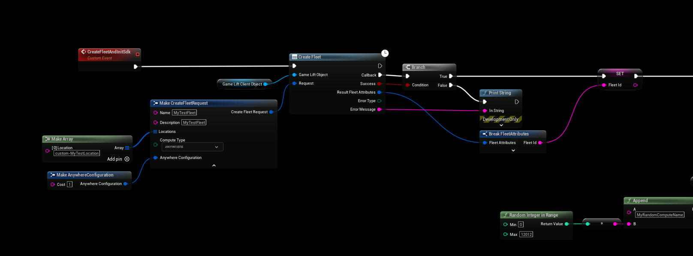
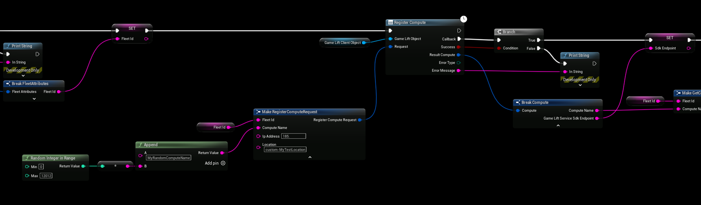
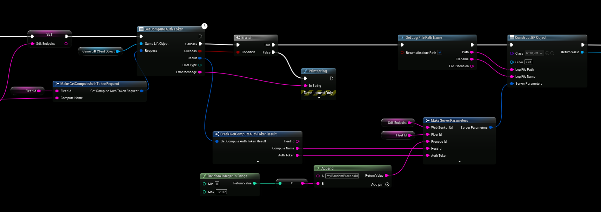
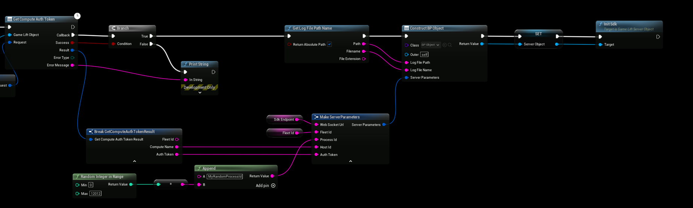

# GameLift Anywhere

With GameLift Anywhere, the server runs on your own machine instead of an EC2 instance. You register the machine as a **compute** in an Anywhere fleet, and the server connects to GameLift with an auth token.

On an Anywhere fleet GameLift doesn't set the Server Parameters for you, so you fill them in before you call **Init Sdk**. Registering the compute and getting the auth token are GameLift service calls, so you need the [GameLift Client](/plugins/gameliftclient/intro) plugin for them.

:::warning
The examples below only show the idea. Don't put AWS access keys in a server build that you give to other people. In a live project, register computes and get auth tokens from a backend or a script, and pass the values to the server on the command line.
:::

## Set up the fleet
Do this once, in the AWS console or with the Client plugin:
1. Create a custom location, for example `custom-home-pc`, with **Create Location**.
2. Create a fleet with the compute type **ANYWHERE** and the custom location, with **Create Fleet**.

## Register the compute and get a token
Before the server starts, or when it starts:
1. Call **Register Compute** with the Fleet Id, a **Compute Name** of your choice, the machine's **IP Address** and the custom **Location**. The result has the **Game Lift Service Sdk Endpoint**, which is the Web Socket Url the server connects to.
2. Call **Get Compute Auth Token** with the Fleet Id and the Compute Name. The result has the **Auth Token** and its **Expiration Timestamp**.

The auth token expires. Get a new one each time you start a server process.

## Fill in the Server Parameters
Set the **Server Parameters** on the Server Object before you call **Init Sdk**:

| Parameter | Value |
|---|---|
| Web Socket Url | **Game Lift Service Sdk Endpoint** from Register Compute. |
| Fleet Id | The Id of the Anywhere fleet. |
| Host Id | The **Compute Name** you registered. |
| Process Id | A unique id for this server process, for example a new GUID. |
| Auth Token | The **Auth Token** from Get Compute Auth Token. |

Leave Aws Region, Access Key, Secret Key and Session Token empty when you use an auth token.

Then construct your Server Object with the Server Parameters, store it in a variable and call **Init Sdk**.

## Create a game session
The server is now ready, but nothing happens until a game session is created on the fleet. Call **Create Game Session** in the Client plugin with the Fleet Id and the custom Location. GameLift then calls **Start Game Session** on your Server Object.

## Video tutorial
[GameLift Anywhere with Unreal Engine 5](/plugins/gameliftclient/videos/gamelift_anywhere) shows the full setup.
