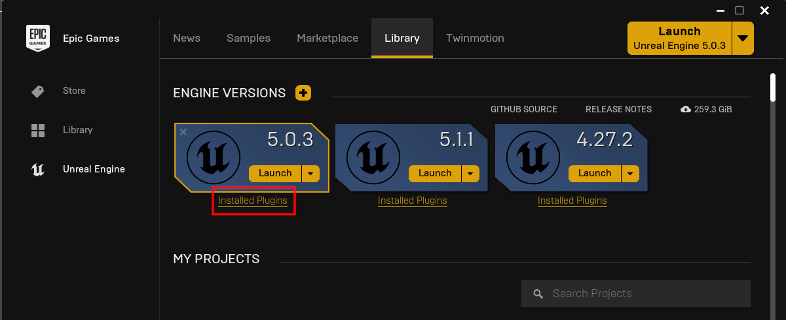
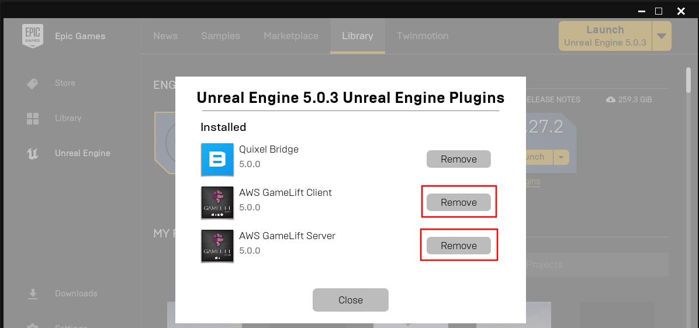
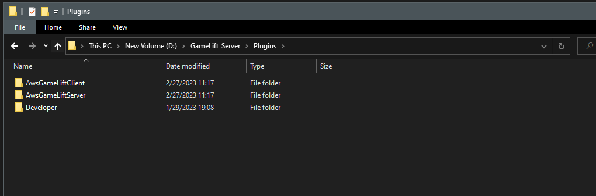

# Updating the Plugin

The Epic Games Launcher does not always update plugins properly. A clean install is the safest way to update.

## Remove the old plugin from the engine
Open **Installed Plugins** for your engine version in the launcher and remove the plugin.

## Delete the plugin from your project
Delete the plugin folder from the **Plugins** folder of your project.

## Install the new version
Install the plugin again from the launcher and follow the [install instructions](/plugins/gameliftserver/installing_plugin).
