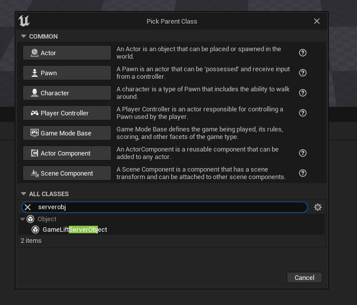
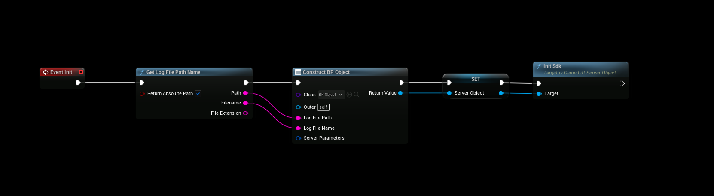
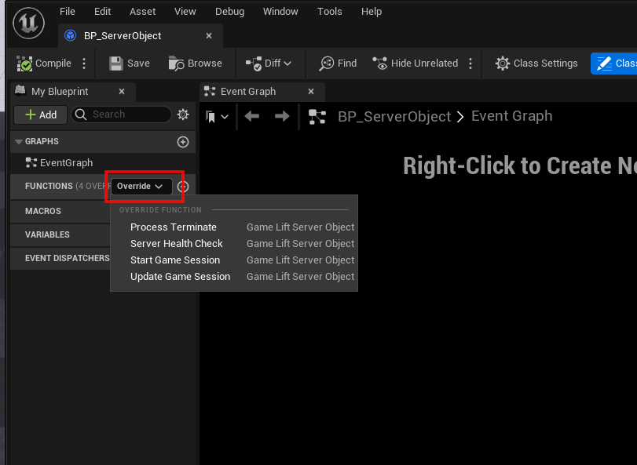

# Using the Plugin

Everything on the server goes through a **GameLift Server Object**. You create it once when the server starts, call **Init Sdk** on it, and override its events to decide what happens when GameLift starts a game session or shuts the server down.

## Requirements
- A dedicated server build of your game. See the Unreal Engine documentation on how to set one up.
- A GameLift fleet to run the server on: a managed EC2 fleet, or an [Anywhere fleet](/plugins/gameliftserver/gamelift_anywhere).

## Create a Server Object
Create a Blueprint class with **GameLift Server Object** as the parent class. This is where you override the server events.



## Initialize the server
Construct your Server Object, for example in the Game Mode or Game Instance on **Begin Play**, and call **Init Sdk** on it.



:::warning
Store the Server Object in a variable. The plugin only keeps a weak reference to it, so if nothing references it, it is garbage collected and your events stop being called.
:::

Init Sdk does two things:
1. It connects to GameLift with the **Server Parameters** on the object.
2. It calls **ProcessReady**, which tells GameLift that the server can host a game session. It reports the port the server listens on and the log file GameLift should upload when the game session ends.

On a **managed EC2 fleet**, leave the Server Parameters empty. GameLift sets them through environment variables on the instance, and the Server SDK reads them from there.

On an **Anywhere fleet**, you fill in the Server Parameters yourself. See [GameLift Anywhere](/plugins/gameliftserver/gamelift_anywhere).

### Server Object properties
| Property | Description |
|---|---|
| Server Parameters | Connection settings: Web Socket Url, Fleet Id, Process Id, Host Id, Auth Token, Aws Region, Access Key, Secret Key and Session Token. Only needed for Anywhere fleets. |
| Log File Path | The folder of the log file that GameLift uploads when a game session ends. Defaults to the project's `Saved/Logs` folder. |
| Log File Name | The name of the log file. Defaults to `gamelift_log.txt`. |

### The listen port
The port reported to GameLift is the port of the server's world. You can override it with `-port=` on the command line, which is how you run several server processes on the same instance. Set the launch path parameters in your fleet's runtime configuration, for example:

```
-port=7777
```

## Server events
Override these events in your Server Object. They are always called on the game thread.



| Event | When it is called | Default behavior |
|---|---|---|
| Start Game Session | GameLift has placed a game session on this server. The **Session** has the game session id, properties, matchmaker data and maximum player count. | Calls **Activate Game Session**. If you override it, call Activate Game Session yourself when the server is ready for players, for example after loading the map. |
| Update Game Session | FlexMatch backfill updated the matchmaker data, or a backfill failed, timed out or was cancelled. See **Update Reason**. | Does nothing. |
| Process Terminate | GameLift is shutting down this server process, for example during a scale-down or an instance interruption. | Calls **Process Ending** and exits the server. If you override it, save what you need, then call **Process Ending** and quit. **Get Termination Time** tells you how much time you have. |
| Server Health Check | Every 60 seconds. Return false if the server is unhealthy. | Returns true. |

:::info
The Server SDK asks for the health check on a background thread. The plugin answers right away with the result of the previous check and runs your event on the game thread, so a change is reported one health check later.
:::

## Players joining
Clients connect to the IP address and port of the game session with the player session id they got from **Create Player Session**. The server must accept the player session with **Accept Player Session** when the player connects, and remove it with **Remove Player Session** when the player leaves.

The included **GameLift Server Game Mode** does this for you. See [Game Mode](/plugins/gameliftserver/game_mode).

## Ending the server
Call **Process Ending** when the game session is over and the server should shut down. GameLift then terminates the process and starts a new one in its place.

**Destroy GameLift Server** calls Process Ending, shuts down the Server SDK and stops sending events to the Server Object. Call it before the server exits if you shut it down yourself.

## Next steps
- [GameLift Anywhere](/plugins/gameliftserver/gamelift_anywhere): run the server on your own machine.
- [Game Mode](/plugins/gameliftserver/game_mode): validate player sessions.
- [Blueprint Nodes](/plugins/gameliftserver/blueprint_nodes): all nodes in the plugin.
