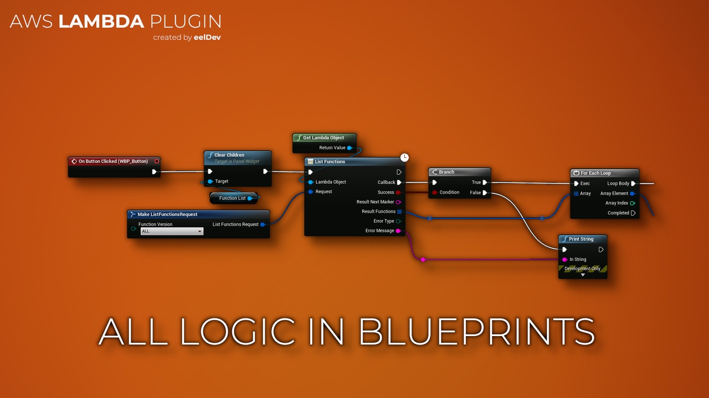
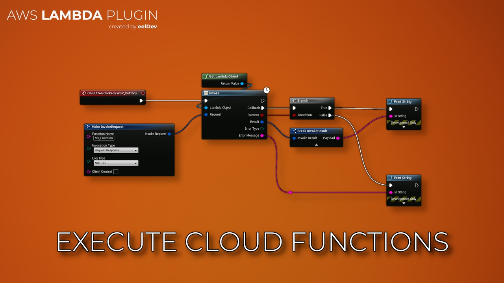
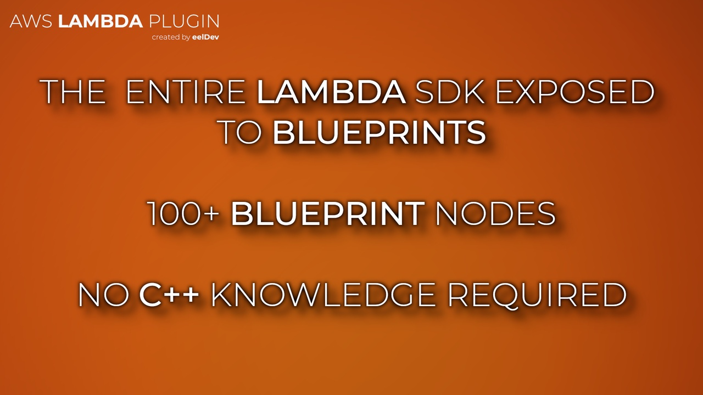

import Tabs from '@theme/Tabs';
import TabItem from '@theme/TabItem';

# Lambda

The Lambda plugin lets you use AWS Lambda from Blueprint. Lambda runs your own code in the cloud without a server. Use it for game logic that should not run on the client, such as validating purchases, granting rewards or talking to other services.

## Features
- **Invoke** a function with a JSON body and get its response.
- **Functions**: create, get, update, delete and list functions, versions and aliases.
- **Layers**, **event source mappings**, **concurrency**, **code signing** and **permissions**.
- All nodes have the same names as in the [Lambda API Reference](https://docs.aws.amazon.com/lambda/latest/api/welcome.html).

<Tabs>
  <TabItem value="image" label="Image" default>
    
  </TabItem>
  <TabItem value="image2" label="Image 2">
    
  </TabItem>
  <TabItem value="image3" label="Image 3">
    
  </TabItem>
</Tabs>

## Requirements
| | |
|---|---|
| Target platforms | Windows, Linux, Mac, Android, iOS |
| Unreal Engine | See the [Fab listing](https://www.fab.com/listings/d9094934-209f-4c4c-85e1-955c66f1132f) for the supported engine versions |

## Where to go next
1. [Install the plugin](/installing_plugin)
2. [Getting Started](/plugins/lambda/getting_started)
3. [Invoking Functions](/plugins/lambda/invoking)
