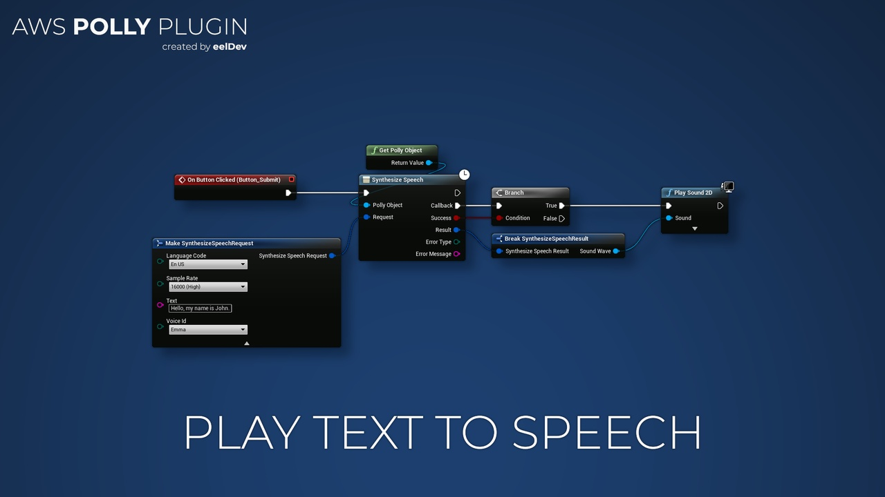
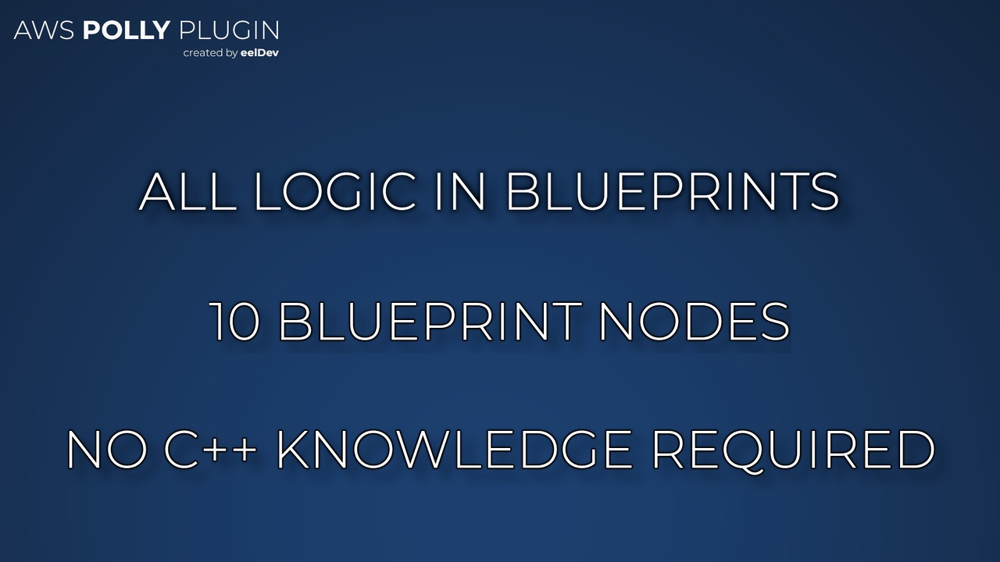

import Tabs from '@theme/Tabs';
import TabItem from '@theme/TabItem';

# Polly

The Polly plugin lets you use Amazon Polly from Blueprint. Polly turns text into lifelike speech. The plugin gives you the speech as a sound that you can play like any other sound in Unreal Engine.

## Features
- **Synthesize Speech** returns the speech as a **Polly Audio** sound wave that you can play directly.
- **Speech marks** with word, sentence, viseme and SSML timings, for example for lip sync or subtitles.
- **SSML** for pauses, emphasis and pronunciation.
- **Voices**: Describe Voices lists the voices for a language.
- **Lexicons** for custom pronunciation, and **speech synthesis tasks** for long texts saved to S3.
- All nodes have the same names as in the [Polly API Reference](https://docs.aws.amazon.com/polly/latest/dg/API_Reference.html).

<Tabs>
  <TabItem value="image" label="Image" default>
    
  </TabItem>
  <TabItem value="image2" label="Image 2">
    
  </TabItem>
  <TabItem value="image3" label="Image 3">
    
  </TabItem>
</Tabs>

## Requirements
| | |
|---|---|
| Target platforms | Windows, Linux, Mac, Android, iOS |
| Unreal Engine | See the [Fab listing](https://www.fab.com/listings/776e973a-f20c-4530-a31e-c53bd0337b40) for the supported engine versions |

## Where to go next
1. [Install the plugin](/installing_plugin)
2. [Getting Started](/plugins/polly/getting_started)
3. [Text to Speech](/plugins/polly/text_to_speech)
