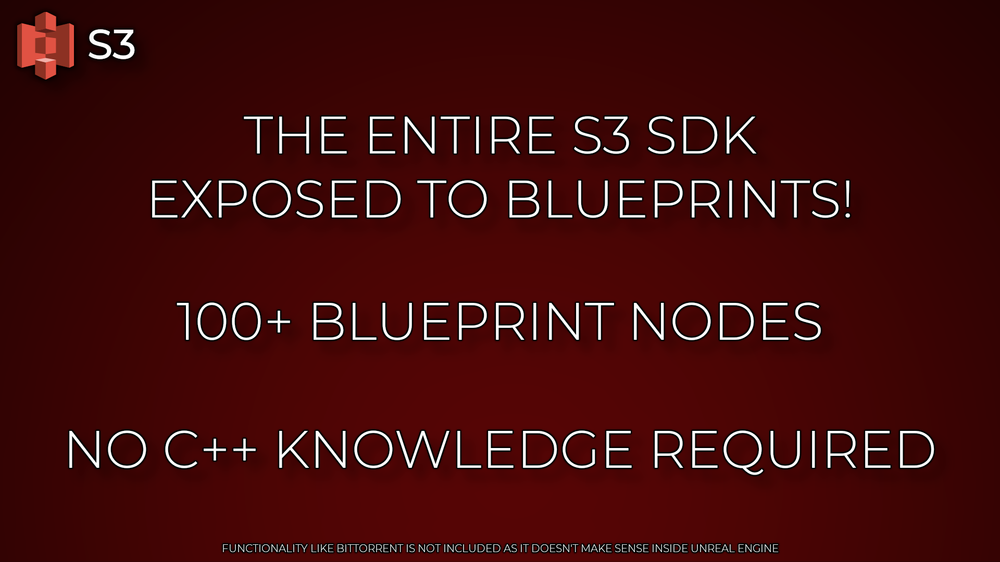
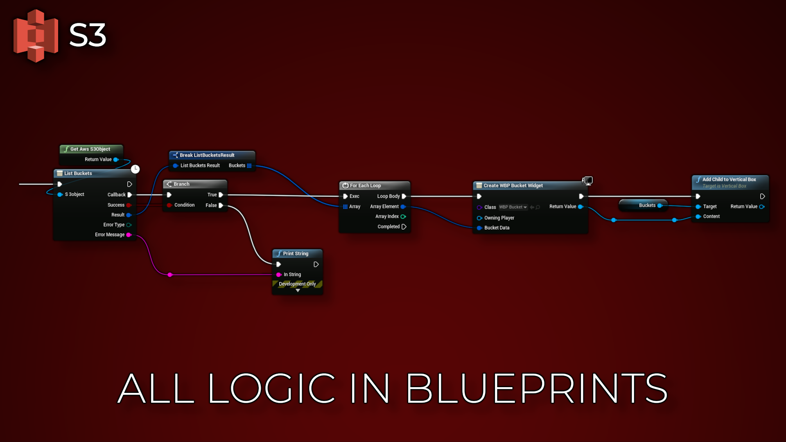
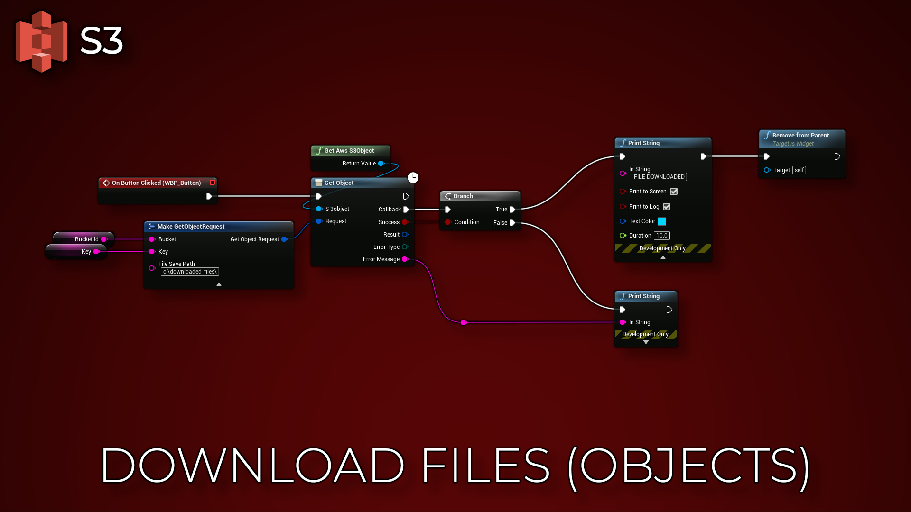

import Tabs from '@theme/Tabs';
import TabItem from '@theme/TabItem';

# S3

The S3 plugin lets you use Amazon S3 from Blueprint. S3 stores files, called objects, in buckets. Use it for save games, user-generated content, patches and other downloadable content.

## Features
- **Files**: Put Object uploads a file from disk, Get Object downloads to disk, with Range for large files and resumable downloads.
- **Multipart uploads** for large files.
- **Objects**: list, copy, delete, tag and lock objects, and read their metadata with Head Object.
- **Buckets**: create, list and delete buckets, and manage their policies, CORS, lifecycle, versioning, encryption and website settings.
- **File helpers** in Blueprint: Directory Exists, Create Directory, Delete File, Move File, File Size On Disk and Iterate Directory.
- All nodes have the same names as in the [S3 API Reference](https://docs.aws.amazon.com/AmazonS3/latest/API/Welcome.html).

<Tabs>
  <TabItem value="image" label="Image" default>
    
  </TabItem>
  <TabItem value="image2" label="Image 2">
    
  </TabItem>
  <TabItem value="image3" label="Image 3">
    
  </TabItem>
</Tabs>

## Requirements
| | |
|---|---|
| Target platforms | Windows, Linux, Mac, Android, iOS |
| Unreal Engine | See the [Fab listing](https://www.fab.com/listings/257a87cb-907a-415a-b869-6bd15faec91c) for the supported engine versions |

## Where to go next
1. [Install the plugin](/installing_plugin)
2. [Getting Started](/plugins/s3/getting_started)
3. [Uploading and Downloading](/plugins/s3/files)
