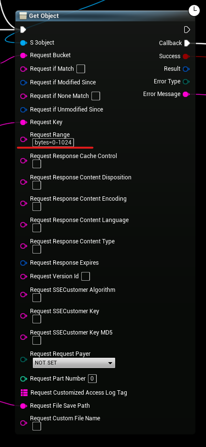
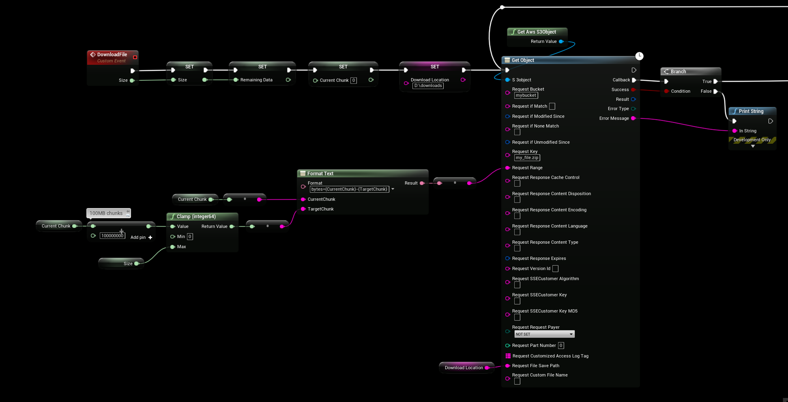
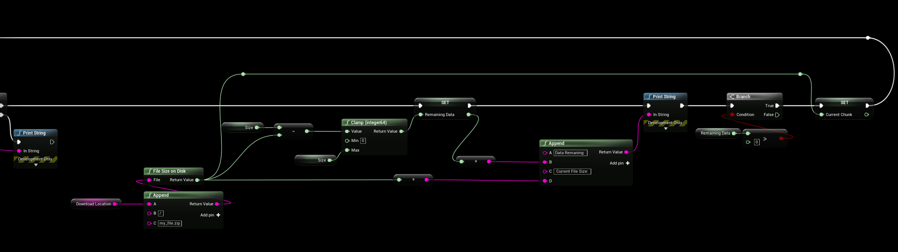

# Downloading Large Files

**Get Object** loads the whole download into memory before it writes it to disk. For files of 100 MB or more, download them in chunks with **Range** instead. That also lets you show progress and resume a download.

## Range
Set **Range** to `bytes=from-to`. This downloads the first 1024 bytes:

```
bytes=0-1023
```



When **Range** is set, Get Object **appends** the bytes to the file instead of replacing it.

:::warning
Delete the file before you start a new chunked download. Otherwise the first chunk is appended to the old file.
:::

## Example
This example downloads `my_file.zip` in 100 MB chunks (100000000 bytes) to `D:\downloads\my_file.zip`.



In the callback, it checks the size of the file on disk with **File Size On Disk**. If there is more to download, it calls Get Object again from that size, so the next chunk is 100–200 MB, and so on. Use **Head Object** first to get the total size, and divide the file size by it for progress.



To resume a download later, start from the size of the file that is already on disk.
