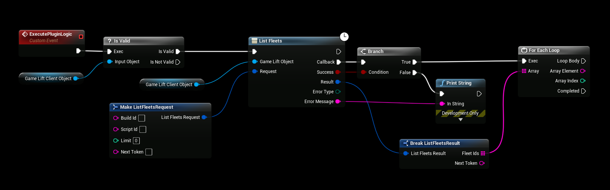
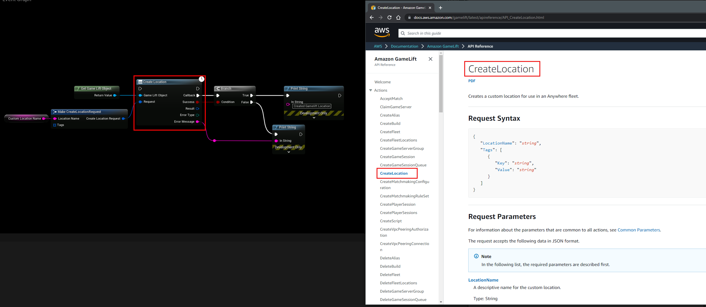

# Using the Plugin

All AWS actions are async nodes. Pass the [client object](/initializing_plugin) and a **Request**, and use the **Callback** pin. The node calls it when AWS has answered, with:

| Output | Description |
|---|---|
| Success | True if the call succeeded. |
| Result | The response from AWS. |
| Error Type | The AWS error, for example `ACCESS_DENIED` or `RESOURCE_NOT_FOUND`. |
| Error Message | The error message from AWS. |

This example lists the active GameLift fleets:

## Follow the AWS documentation
The nodes, requests and fields have the same names as in the AWS API documentation. You find the link to the API documentation of each plugin in the sidebar, under the plugin.

## Common errors
| Error Type | What to check |
|---|---|
| `ACCESS_DENIED`, `UNAUTHORIZED` | The IAM user doesn't have permission for the action. Add it to the user's policy. |
| `INVALID_CLIENT_TOKEN_ID`, `SIGNATURE_DOES_NOT_MATCH` | The access key or secret key is wrong, or the session token is missing for temporary credentials. |
| `REQUEST_TIME_TOO_SKEWED` | The computer's clock is wrong. |
| `RESOURCE_NOT_FOUND` | The resource doesn't exist, or it is in another region than the client object. |
| `NETWORK_CONNECTION` | AWS could not be reached. |

To see what the plugin does, turn on verbose logging. See the Logging page of the plugin.
